# Course Smash

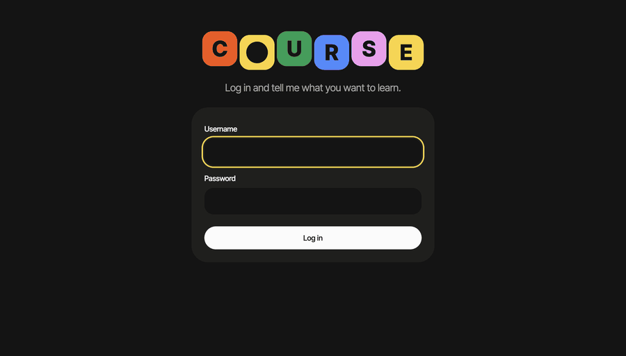

Say what you want to learn. An agent builds a course of multiple-choice and short-answer questions, multiple-choice answers are checked against the answer key, a decision model rates short answers against your goal, and the agent reads your results to write what comes next.

The same app runs on Cloudflare or in Docker.

The design is by [Ayush Soni](https://x.com/ayushsoni_io).

## How it works

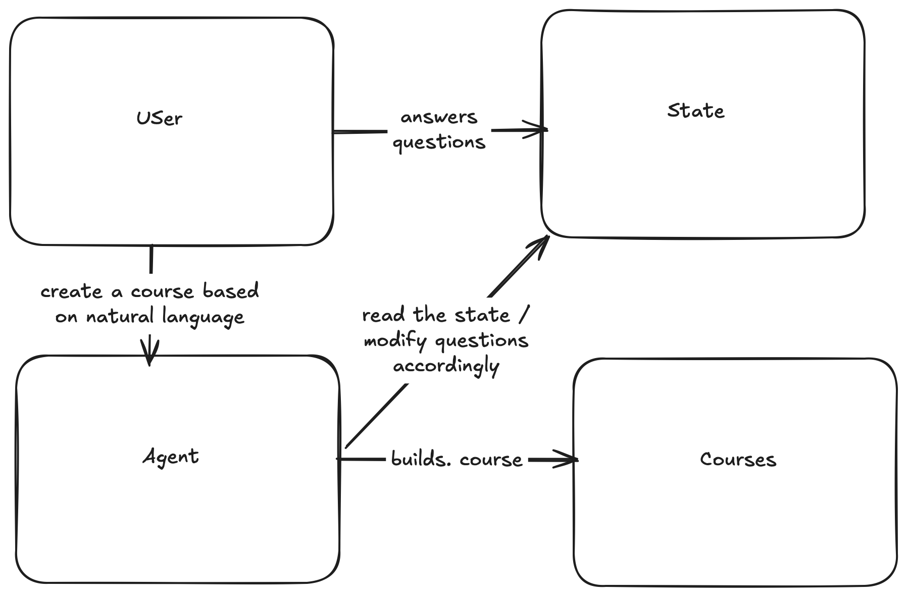

1. You describe what you want to learn, and the agent plans modules and writes the first questions.
2. You answer. Multiple-choice answers are checked against the answer key with no model involved. Short answers are rated by the decision model against your goal, and a writing model explains the result.
3. Your answers go into the learner state. When a round ends, the decision model reads that state and either adds follow-up questions on weak concepts or moves you on.

## Screenshots

| | |
|---|---|
| 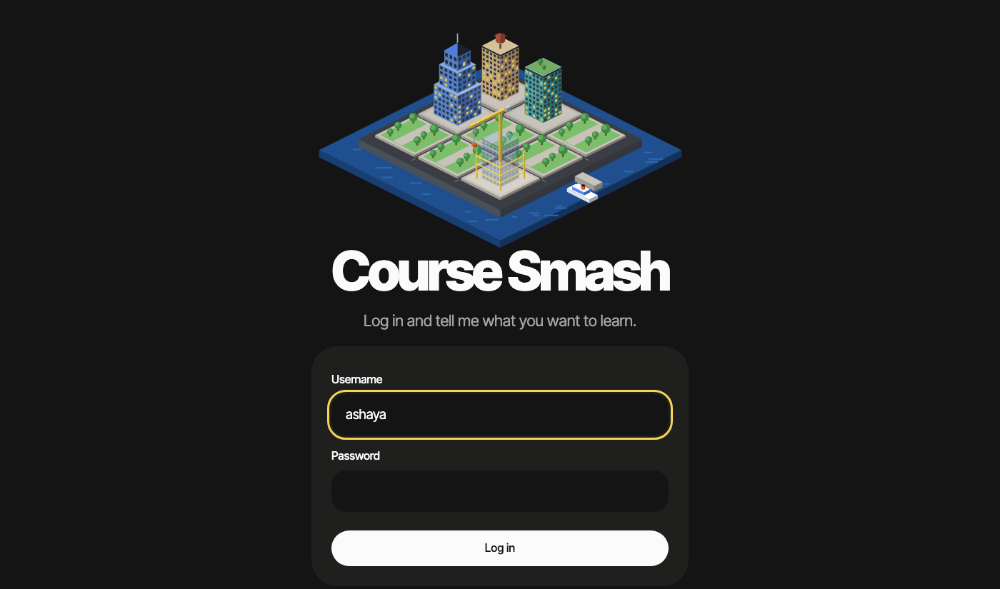 | 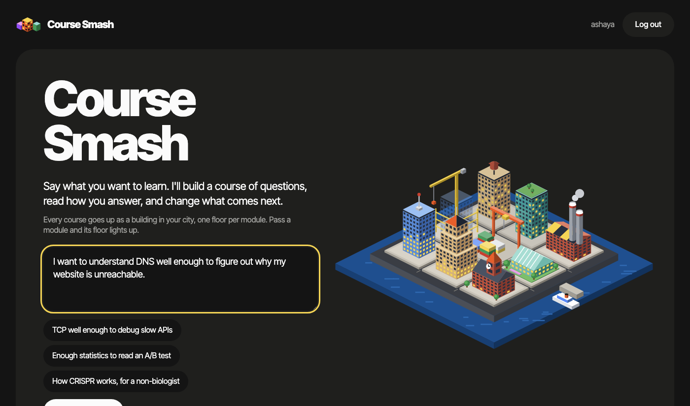 |
| Log in | Describe what you want to learn |
| 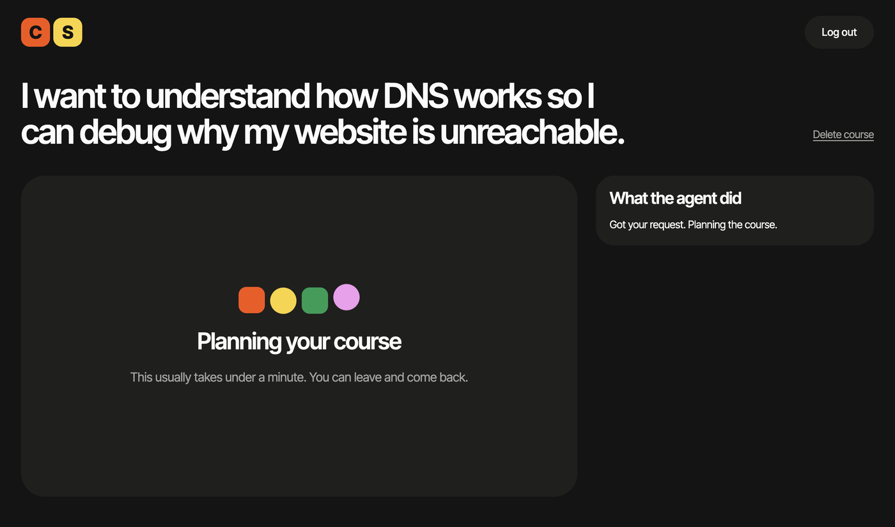 | 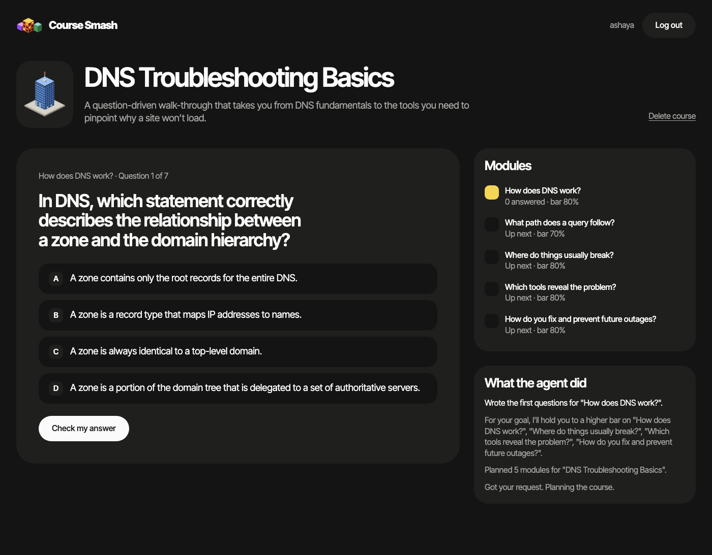 |
| The agent plans the course | Answer a multiple-choice question |
| 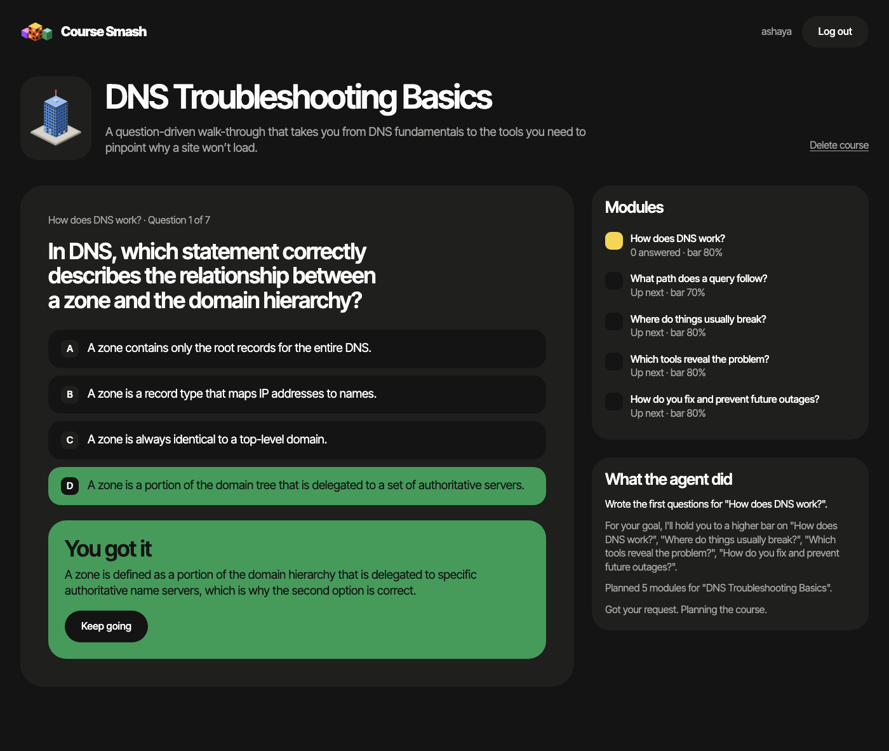 | 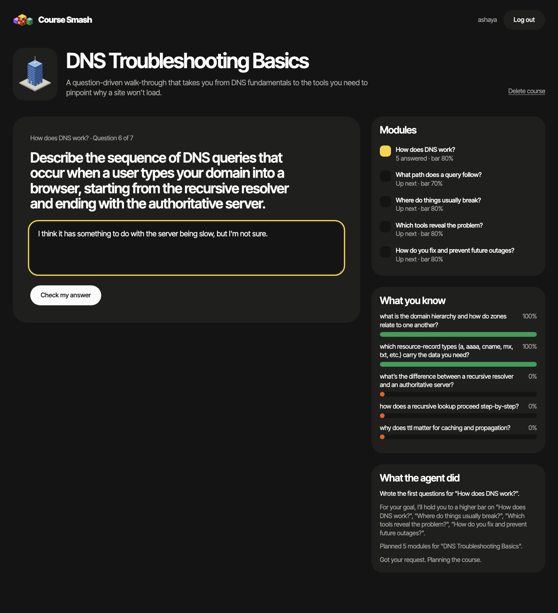 |
| Checked against the answer key | Write a short answer |
| 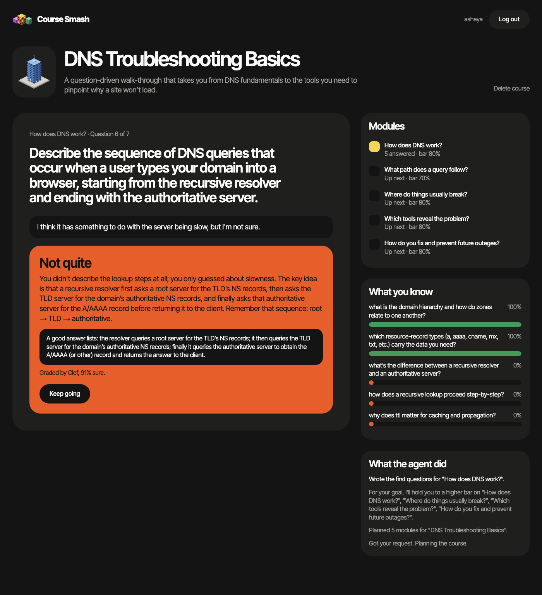 | 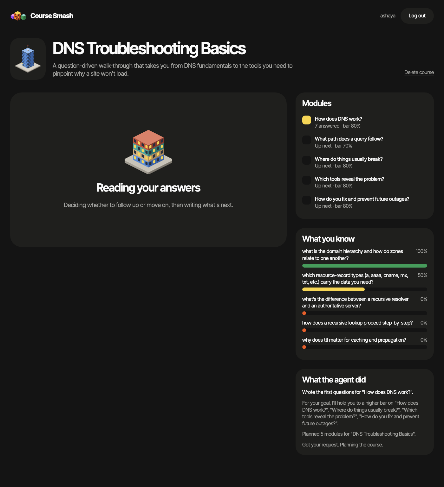 |
| Rated by the decision model | The agent reads your answers |
| 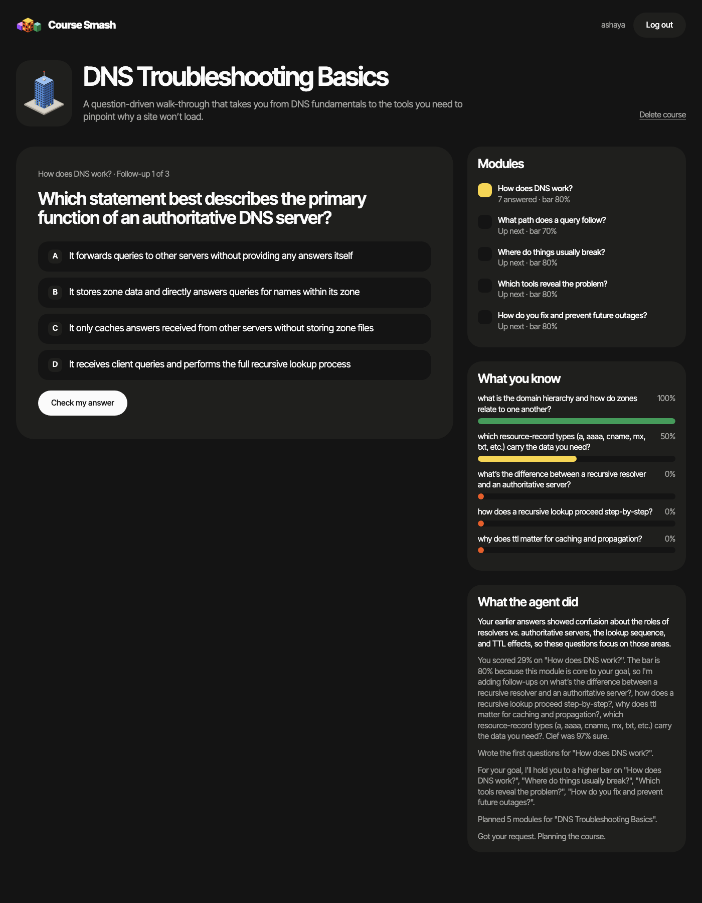 | 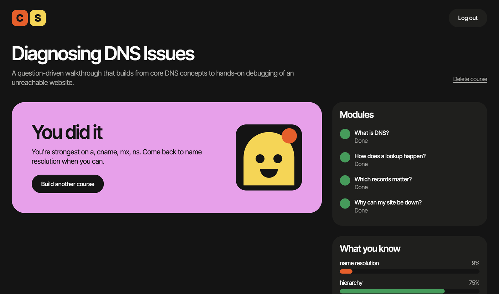 |
| Follow-ups aimed at your weak spots | Finish the course |

| | Cloudflare | Docker |
|---|---|---|
| Runtime | Workers | Node 22 (`src/server/node.ts`) |
| Database | D1 | SQLite file in a volume |
| Static files | Assets | Served from `public/` |
| Login rate limit | Rate Limiting binding | In memory |
| Decision model | Clef | Clef, or any OpenAI-compatible model |
| Writing model | gpt-oss on Workers AI | gpt-oss on Workers AI, or any OpenAI-compatible model |

## Run with Docker

```sh
cp .env.example .env   # set USER_NAME, PW and one inference option
docker compose up --build
```

Open http://localhost:8787. Set `PORT` in `.env` to use a different host port. Answers live in the `coursesmash-data` volume and migrations run at startup.

If you serve it over HTTPS, put it behind a reverse proxy that sets `X-Forwarded-Proto: https`, so the session cookie is marked `Secure`. Behind a proxy, every visitor shares one IP for the login rate limit.

Without Docker, on Node 22:

```sh
npm ci && npm run build:server
set -a; source .env; set +a; npm run start:server
```

## Develop on Cloudflare's runtime

```sh
npm ci
cp .env.example .dev.vars   # fill it in; delete the OpenAI lines unless you use them
npm run db:migrate:local
npm run dev
```

## Deploy to Cloudflare

1. In `wrangler.jsonc`, set `account_id`, `vars.CLOUDFLARE_ACCOUNT_ID`, the `routes` domain and the D1 `database_id` to your own. Create the database with `npx wrangler d1 create coursesmash-db`.
2. Set the secrets: `npx wrangler secret put USER_NAME`, then the same for `PW` and `CLOUDFLARE_API_KEY`.
3. Run `npm run deploy`, which applies D1 migrations and then deploys.

To deploy on every git push, connect the repo in Workers Builds and use `npm run deploy` as the deploy command. The build's API token needs D1 edit access, since the command runs migrations.

## Accounts

The admin login comes from the `USER_NAME` and `PW` secrets. Add more people with `scripts/add-user.mjs`, which stores a PBKDF2 hash of the password, never the password itself. Each account sees only its own courses, on the web and over MCP.

```sh
# Cloudflare
NEW_PASSWORD='their-password' node scripts/add-user.mjs <username> > user.sql
npx wrangler d1 execute coursesmash-db --remote --file user.sql && rm user.sql

# Docker
docker compose exec -e NEW_PASSWORD='their-password' coursesmash node scripts/add-user.mjs <username> --sqlite /data/coursesmash.db
```

Run the same command again to change a password. That also signs the person out everywhere.

## MCP

`/mcp` serves MCP over Streamable HTTP, with `Authorization: Basic base64(username:password)` for any account. Tools: `create_course`, `list_courses`, `get_course`, `answer_question`, `advance_course`.

## Check your work

```sh
npm run typecheck
node --experimental-strip-types evals/run_evals.mjs
```

## Evals

`evals/` holds 140 synthetic cases: 40 on course quality, 50 on question quality and 50 on grading decisions. The harness validates them and scores local heuristic graders, with no API calls. Its baseline numbers describe those heuristics, not Clef or any other model. See [evals/README.md](evals/README.md).

> [!CAUTION]
> This eval set is educational. It was generated with frontier-model subagents for a live demo. Don't use frontier models to create eval sets for your own work unless you've checked the provider's usage policy first.

### Development

Built during a 15-minute demo at the BIOS SPHERE conference, starting from a hand-drawn sketch (above) and this prompt:

```text
I'd like to build a course agent where a user can use a prompt to generate a multiple-choice questionnaire-based module course on a topic. There should be a database where we have some state that the course answers go to. The agent should then create some questions based on the feedback. The questions should be multiple-choice and also short answer.

Let's have a GPT-based decision model actually evaluate the course outputs, and let's use my common infrastructure substrate to deploy this. Let's use Ayush's. Ayush, I'm going to use your Hex UI that you just built. I'm going to use hex.ig/bio-world, I think, as the design system, and let's deploy it
```

The eval set came from this prompt:

```text
Spin up five subagents to create evals for this task. Use synthetic data. Use your own harness and
do not use any external API calls. Create data for both whether or not something is a good question
and whether or not something is a good course, and also for grading of the question that will be
done by the decision model. I want you to create an eval set.
```
